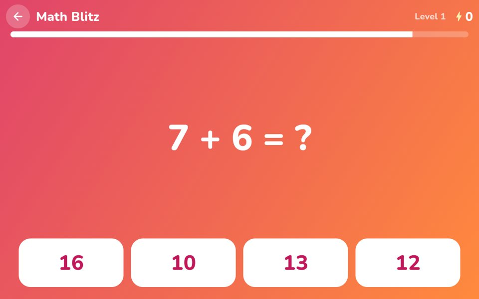
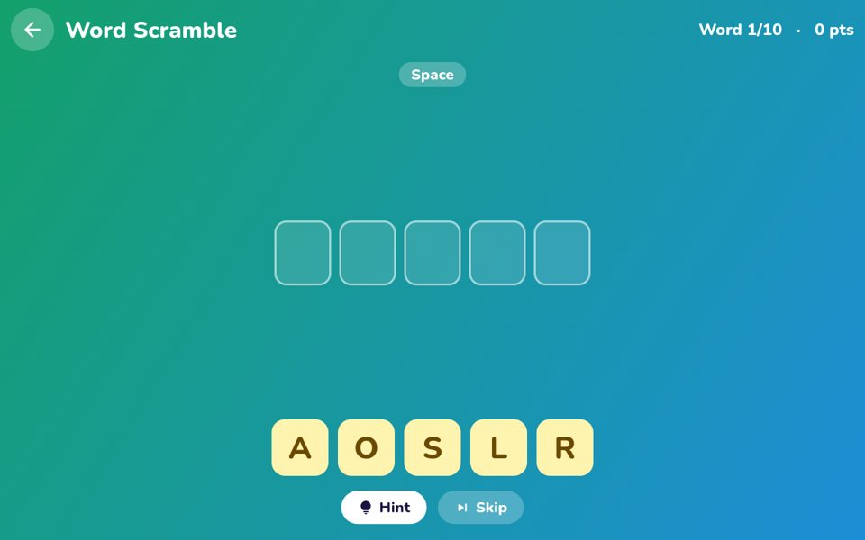
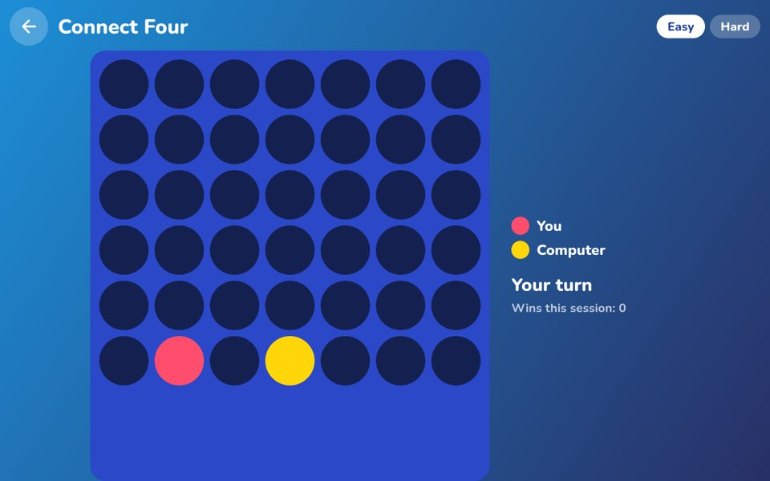
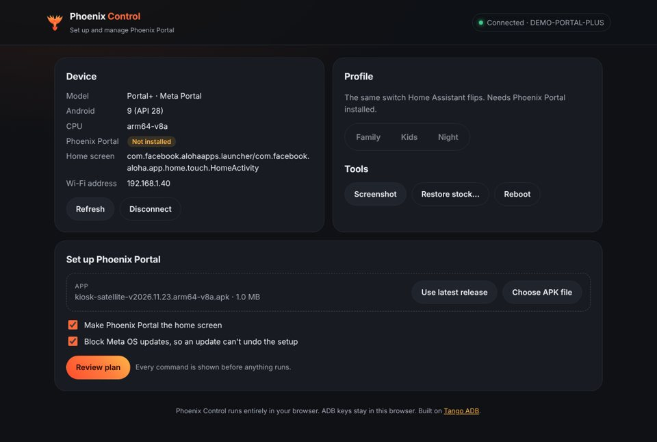

<h1 align="center">
  <picture>
    <source media="(prefers-color-scheme: dark)" srcset="assets/banners/ks_banner_dark.svg" />
    <source media="(prefers-color-scheme: light)" srcset="assets/banners/ks_banner_light.svg" />
    
  </picture>
</h1>

<p align="center">
  <b>Phoenix Portal</b> brings a Meta Portal back to life as a <b>Home Assistant hub</b>, a <b>kids game portal</b> and a <b>photo frame</b>.<br/>
  Fully local. No Facebook account. Built for the Portal's Android 9 and 10.
</p>

<p align="center">
  
</p>

## What it does

**Home Assistant hub.** Your Home Assistant dashboard full screen, with Assist voice control and
wake words, timers, alarms, a family calendar, camera views, intercom between Portals and
synchronized music. The Portal shows up in Home Assistant through ESPHome with its screen,
volume, sensors, presence, and the new **Profile** switch.

**Kids Portal.** A game hub made for a 9-year-old, offline and ad-free:

| Game | What it is |
|---|---|
| **Math Blitz** | 60 seconds against the clock. Levels climb from + and − to 12× tables and division. |
| **Word Scramble** | Ten themed words a round (animals, space, sports, science), with hints and skips. |
| **2048** | Slide and merge to 2048. |
| **Connect Four** | Against the computer, Easy or Hard. |
| **Memory Pro** | Eight pairs on the clock. |
| **Draw Studio** | Finger painting with an eraser, undo and brush sizes. |

Scored games keep a best and earn ⭐ stars. Below the games sit the apps a parent allows
(Lemuroid for retro games, GCompris, Tux Paint, …). Parents get a **daily screen-time budget**,
a **bedtime window**, and a **parent PIN** (or a three-second press on the lock). Leaving the
portal or adding time needs a grown-up.

<p align="center">
  
  
  
</p>

**Profiles: Family / Kids / Night.** Family is the normal hub. Kids keeps the screen on the Kids
Portal. Night shows a calm bedtime clock. Switch from Home Assistant, Phoenix Control, the remote
admin or the Portal itself.

**App Store.** Free apps picked for Portal (games, learning, media, smart home, tools), installed
from F-Droid's current builds with one tap.

<p align="center"></p>

**Photo frame and screensavers.** Immich albums, local photos, clocks, weather mood and a night
sky, woken by the Portal's own presence sensor.

**Made for the Portal.** Phoenix fixes the first-generation Portal's white-on-white installer
dialog, can block Meta OS updates so they don't undo the setup, takes over the home screen, and
keeps Meta's own accessibility services running.

## Set up a Portal

### Phoenix Control (in the browser)

[Phoenix Control](control/) sets up a Portal from Chrome or Edge over USB, with nothing to
install. It reads the device, **shows every command before it runs**, installs Phoenix Portal,
applies the Portal fixes and makes it the home screen. Afterwards, switch profiles, take
screenshots or **restore** the stock Portal. Try it without a device by adding `?demo` to the
address.

<p align="center"></p>

1. On the Portal, turn on ADB (Settings → Debugging; on Portal TV, Developer options).
2. Connect it with a USB-C data cable and open Phoenix Control.
3. **Connect device**, tap **Allow** on the Portal, choose the APK, **Review plan**, **Apply**.

### Or from a terminal

```bash
./provisioning/phoenix-provision.sh --dry-run    # print the plan only
./provisioning/phoenix-provision.sh              # set up (asks before applying)
./provisioning/phoenix-provision.sh --restore    # back to the stock Portal
```

Both tools run the same steps. Finish the on-screen wizard, or continue from a computer at
`http://<portal-ip>:2324`.

## Home Assistant

The Portal appears in **Settings → Devices & services** as a discovered ESPHome device. Besides the
screen, volume, sensors, cameras and media entities, Phoenix adds:

- `select.<portal>_profile`: Family / Kids / Night
- `sensor.<portal>_kids_time_left`: minutes of screen time left today

```yaml
# Kids mode after school on weekdays, bedtime screen at night.
automation:
  - alias: Portal kids mode after school
    trigger: { platform: time, at: "15:30:00" }
    condition: { condition: time, weekday: [mon, tue, wed, thu, fri] }
    action:
      - action: select.select_option
        target: { entity_id: select.kids_room_portal_profile }
        data: { option: Kids }
  - alias: Portal bedtime
    trigger: { platform: time, at: "20:30:00" }
    action:
      - action: select.select_option
        target: { entity_id: select.kids_room_portal_profile }
        data: { option: Night }
```

The [remote API](docs/remote-api.md) takes the same actions: `setProfile`, `openKids`, `kidsAddTime`,
`kidsStatus`, `openStore`, `storeInstall`.

## Documentation

- **Phoenix:** [plan and status](docs/phoenix/PLAN.md), [Meta Portal guide](docs/portal.md),
  [Phoenix Control](control/README.md)
- **Display:** [screen](docs/screen.md), [screensavers](docs/screensavers.md),
  [Immich](docs/immich.md), [custom pages](docs/custom-pages.md), [At a Glance](docs/at-a-glance.md)
- **Voice and media:** [Voice Satellite](docs/voice-satellite.md), [microphone](docs/microphone.md),
  [music](docs/sendspin.md), [music library](docs/music-library.md), [intercom](docs/intercom.md),
  [cameras](docs/cameras.md), [DLNA](docs/dlna.md)
- **Kiosk:** [lockdown](docs/kiosk.md), [home launcher](docs/home-launcher.md),
  [gestures](docs/gestures.md), [alarms](docs/alarms.md), [timers](docs/timers.md),
  [calendar](docs/calendar.md), [permissions](docs/permissions.md), [updates](docs/updates.md)
- **Automation and management:** [ESPHome](docs/esphome.md), [fleet](docs/fleet.md),
  [remote API](docs/remote-api.md), [TLS](docs/tls.md), [JavaScript API](docs/js-api.md),
  [plugins](docs/plugins.md)

## Build from source

Flutter 3.44.6 (the version CI pins), JDK 17+, Android SDK and NDK.

```bash
cd app
flutter pub get
flutter build apk --release --split-per-abi --target-platform android-arm,android-arm64
flutter test                                    # Dart tests
(cd android && ./gradlew :app:testDebugUnitTest) # Kotlin tests
```

Releases are built by `.github/workflows/release.yml` when a GitHub release is published. It needs
the signing secrets `ANDROID_KEYSTORE_BASE64`, `ANDROID_STORE_PASSWORD`, `ANDROID_KEY_PASSWORD` and
`ANDROID_KEY_ALIAS`. Phoenix Portal updates itself from this repository's releases. Analytics are
**off by default**.

## Credits

Phoenix Portal is built on [Kiosk Satellite](https://github.com/jxlarrea/kiosk-satellite) by Xavier
Larrea, with Portal provisioning know-how from [Immortal](https://github.com/starbrightlab/immortal)
and ideas from [OpenPortal](https://openportal.cc). Phoenix Control uses
[Tango ADB](https://github.com/yume-chan/ya-webadb). Fonts: Inter, Nunito and Rubik (SIL OFL).
Icons: Material Design. See [LICENSE](LICENSE) and [CHANGELOG.md](CHANGELOG.md).

Not affiliated with Meta. "Portal" is a trademark of Meta Platforms, Inc., used only to name the
hardware Phoenix Portal runs on.
