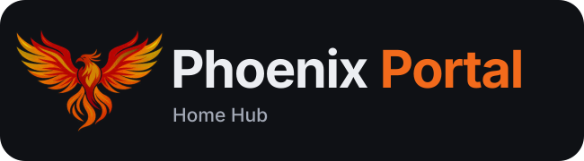

<h1 align="center">
  <picture>
    <source media="(prefers-color-scheme: dark)" srcset="assets/banners/ks_banner_dark.svg" />
    <source media="(prefers-color-scheme: light)" srcset="assets/banners/ks_banner_light.svg" />
    
  </picture>
</h1>

<p align="center">
  <b>Phoenix Portal</b> brings a Meta Portal back to life as a <b>home hub launcher</b>, a <b>kids game portal</b> and a <b>photo frame</b>, with <b>Home Assistant</b> as an optional add-on.<br/>
  Fully local. No Facebook account. Built for the Portal's Android 9 and 10.
</p>

<p align="center">
  
</p>

## What it does

**Phoenix Home.** The home screen is a launcher that needs nothing else. The **Today** screen
shows the time and weather on a 4K photo with live weather effects, glass cards (Home Assistant
cameras you can swipe through, what's up next, school, the Telugu word of the day) and a dock:
Kids Portal, Smart Home, **Calls** (the Portal's own WhatsApp and Messenger calling), Apps,
School, Calendar, Photos and Settings. A doorbell ring shows its camera full screen for 30 s. Every installed app is one
tap away in the app drawer, with search, recent and most-used apps; press and hold an app to add
it to the dock or the Kids Portal, hide it, or open its Android info page.

**Live, resizable tiles and themes.** Every tile shows current data (today's tithi and festival,
the next school lunch, stars and the kids' challenge, running timers, the next alarm, lights on,
your photos) and more of it as it grows. Press and hold, or tap the edit button, to resize tiles
(small, wide, tall, large, extra large or any custom size), reorder or hide them, and pick a theme:
Ember, Ocean, Forest, Midnight, Sunset or Graphite. The background shows the weather: rain, snow,
clouds, fog, sun, stars or a storm.

**Telugu calendar (తెలుగు క్యాలెండర్).** A full panchangam computed on the Portal for your city:
tithi, nakshatra, yoga, karana, masa (adhika masa included), paksha, ritu and samvatsara, sunrise
and sunset, Rahu Kalam and Yamagandam, and the Telugu festivals (Ugadi, Sri Rama Navami, Vinayaka
Chavithi, Dasara, Deepavali, Kartika Pournami, Sankranti and more) in a month view. The tile shows
today's date and what is special about it.

**Photos.** A photo tile and the Phoenix Photo Frame screensaver from Immich (the photo server
most Unraid setups run) or a network folder served over http.

**School.** This week's breakfast and lunch menus from SchoolCafe (Miller Elementary, Frisco
ISD by default; pick your school on the Portal), the Frisco ISD calendar (holidays, early release
days) from its iCal link, and the bell times with a "school starts in 20 min" line.

**Smart Home (Home Assistant, optional).** Quick controls for lights, switches, covers, locks,
climate, players, scenes and scripts, with favourites and rooms, and the full dashboard one tap
away. Without Home Assistant, Phoenix Home works exactly the same; skip it in the setup wizard.
Prefer the dashboard as the home screen? Settings > Home Screen.

**Home Assistant dashboard.** Your Home Assistant dashboard full screen, with Assist voice control and
wake words, timers, alarms, a family calendar, camera views, intercom between Portals and
synchronized music. The Portal shows up in Home Assistant through ESPHome with its screen,
volume, sensors, presence, and the new **Profile** switch.

**Kids Portal.** A game hub made for a 9-year-old, offline and ad-free, on seven shelves:

| Shelf | Games |
|---|---|
| **Learn** | Math Blitz, Times Tables, Telling the Time, Flag Quiz, Word Scramble, Patterns, Fractions, Money, Science, Spelling, Opposites, Count It, Letter Sounds, Place Value, Story Sums, Telugu Words. Levels with stars, a best per level and **Next level** after a good round. |
| **Maps** | USA (50 states), India (28 states and 8 union territories) and World: find it, name it, capitals, continents, flags, fill the whole map, shape memory. |
| **Puzzles** | Sudoku, Maze, Word Search, Word Guess, Memory Pro (6 to 12 pairs), 2048, Lights Out. |
| **Play** | Snake (walls that change every stage), Whack-a-Mole, Simon Says, Tic-Tac-Toe, Connect Four. |
| **Arcade** | Munch Maze, Brick Bash, Hop Across, Sky Glide, Fox Run: original retro games with stages. |
| **Move** | Camera games: Space Blaster, Bubble Pop, Fruit Catcher, Finger Math, Wall Dodge, Air Trace, Freeze Dance (DJ mixes). Two hands, the body shown as soft glowing 3D pixels; every game also plays by touch. |
| **Create** | Draw Studio, Pixel Paint, Piano. |

A **daily challenge** (a new one each day) is worth three bonus stars.

Scored games keep a best and earn ⭐ stars. Above the games sit the apps a parent allows
(Lemuroid for retro games, GCompris, Tux Paint, …). Parents get a **daily screen-time budget**,
a **bedtime window**, and a **parent PIN** (or a three-second press on the lock). Leaving the
portal or adding time needs a grown-up.

<p align="center">
  
  
  
</p>

**Profiles: Family / Kids / Night.** Family is the normal hub. Kids keeps the screen on the Kids
Portal. Night shows a calm bedtime clock. Switch from Home Assistant, Phoenix Control, the remote
admin or the Portal itself.

**App Store.** Free apps picked for Portal (games, learning, media, smart home, tools), installed
from F-Droid's current builds with one tap.

<p align="center"></p>

**Photo frame and screensavers.** Immich albums, local photos, clocks, weather mood and a night
sky, woken by the Portal's own presence sensor.

**Made for the Portal.** Phoenix fixes the first-generation Portal's white-on-white installer
dialog, can block Meta OS updates so they don't undo the setup, takes over the home screen, and
keeps Meta's own accessibility services running.

## Set up a Portal

### Phoenix Control (in the browser)

[Phoenix Control](control/) sets up a Portal from Chrome or Edge over USB, with nothing to
install. It reads the device, **shows every command before it runs**, installs Phoenix Portal,
applies the Portal fixes and makes it the home screen. Afterwards, switch profiles, take
screenshots or **restore** the stock Portal. Try it without a device by adding `?demo` to the
address.

<p align="center"></p>

1. On the Portal, turn on ADB (Settings → Debugging; on Portal TV, Developer options).
2. Connect it with a USB-C data cable and open Phoenix Control.
3. **Connect device**, tap **Allow** on the Portal, choose the APK, **Review plan**, **Apply**.

### Or from a terminal

```bash
./provisioning/phoenix-provision.sh --dry-run    # print the plan only
./provisioning/phoenix-provision.sh              # set up (asks before applying)
./provisioning/phoenix-provision.sh --restore    # back to the stock Portal
```

Both tools run the same steps. Finish the on-screen wizard, or continue from a computer at
`http://<portal-ip>:2324`.

## Home Assistant

The Portal appears in **Settings → Devices & services** as a discovered ESPHome device. Besides the
screen, volume, sensors, cameras and media entities, Phoenix adds:

- `select.<portal>_profile`: Family / Kids / Night
- `sensor.<portal>_kids_time_left`: minutes of screen time left today

```yaml
# Kids mode after school on weekdays, bedtime screen at night.
automation:
  - alias: Portal kids mode after school
    trigger: { platform: time, at: "15:30:00" }
    condition: { condition: time, weekday: [mon, tue, wed, thu, fri] }
    action:
      - action: select.select_option
        target: { entity_id: select.kids_room_portal_profile }
        data: { option: Kids }
  - alias: Portal bedtime
    trigger: { platform: time, at: "20:30:00" }
    action:
      - action: select.select_option
        target: { entity_id: select.kids_room_portal_profile }
        data: { option: Night }
```

The [remote API](docs/remote-api.md) takes the same actions: `setProfile`, `openKids`, `kidsAddTime`,
`kidsStatus`, `openStore`, `storeInstall`.

## Documentation

- **Phoenix:** [plan and status](docs/phoenix/PLAN.md), [Meta Portal guide](docs/portal.md),
  [Phoenix Control](control/README.md)
- **Display:** [screen](docs/screen.md), [screensavers](docs/screensavers.md),
  [Immich](docs/immich.md), [custom pages](docs/custom-pages.md), [At a Glance](docs/at-a-glance.md)
- **Voice and media:** [Voice Satellite](docs/voice-satellite.md), [microphone](docs/microphone.md),
  [music](docs/sendspin.md), [music library](docs/music-library.md), [intercom](docs/intercom.md),
  [cameras](docs/cameras.md), [DLNA](docs/dlna.md)
- **Kiosk:** [lockdown](docs/kiosk.md), [home launcher](docs/home-launcher.md),
  [gestures](docs/gestures.md), [alarms](docs/alarms.md), [timers](docs/timers.md),
  [calendar](docs/calendar.md), [permissions](docs/permissions.md), [updates](docs/updates.md)
- **Automation and management:** [ESPHome](docs/esphome.md), [fleet](docs/fleet.md),
  [remote API](docs/remote-api.md), [TLS](docs/tls.md), [JavaScript API](docs/js-api.md),
  [plugins](docs/plugins.md)

## Build from source

Flutter 3.44.6 (the version CI pins), JDK 17+, Android SDK and NDK.

```bash
cd app
flutter pub get
flutter build apk --release --split-per-abi --target-platform android-arm,android-arm64
flutter test                                    # Dart tests
(cd android && ./gradlew :app:testDebugUnitTest) # Kotlin tests
```

Releases are built by `.github/workflows/release.yml` when a GitHub release is published. It needs
the signing secrets `ANDROID_KEYSTORE_BASE64`, `ANDROID_STORE_PASSWORD`, `ANDROID_KEY_PASSWORD` and
`ANDROID_KEY_ALIAS`. Phoenix Portal updates itself from this repository's releases. Analytics are
**off by default**.

## Credits

Phoenix Portal is built on [Kiosk Satellite](https://github.com/jxlarrea/kiosk-satellite) by Xavier
Larrea, with Portal provisioning know-how from [Immortal](https://github.com/starbrightlab/immortal)
and ideas from [OpenPortal](https://openportal.cc). Phoenix Control uses
[Tango ADB](https://github.com/yume-chan/ya-webadb). Fonts: Inter, Nunito and Rubik (SIL OFL).
Icons: Material Design. See [LICENSE](LICENSE) and [CHANGELOG.md](CHANGELOG.md).

Not affiliated with Meta. "Portal" is a trademark of Meta Platforms, Inc., used only to name the
hardware Phoenix Portal runs on.
