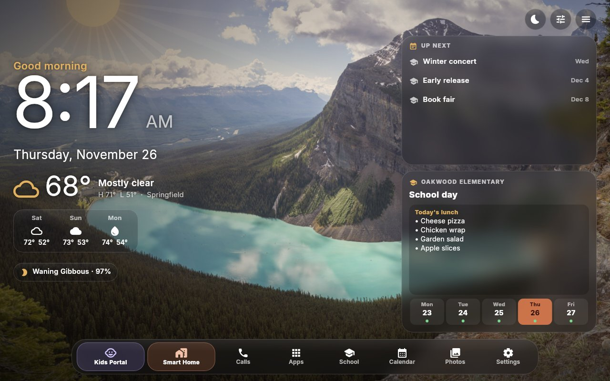
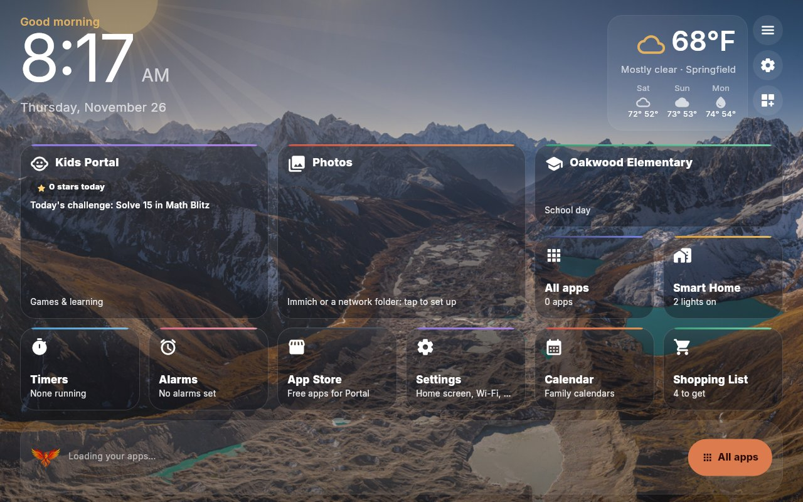
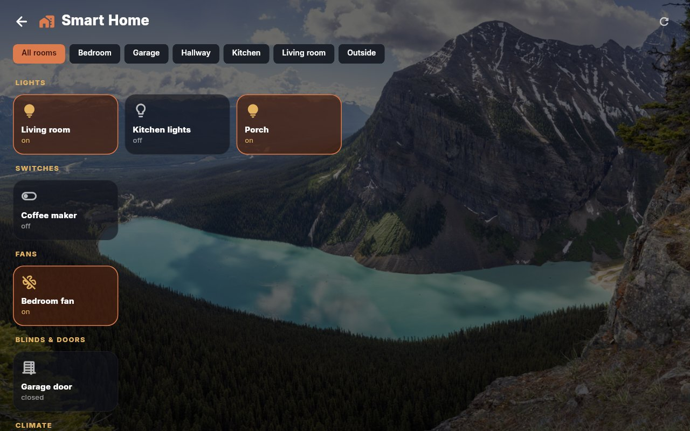
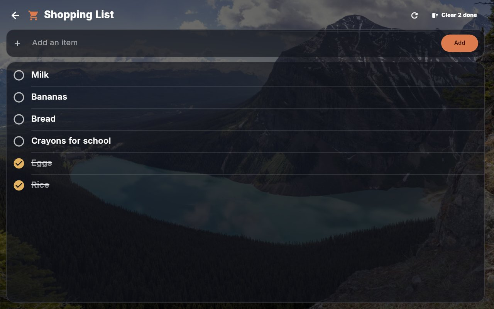
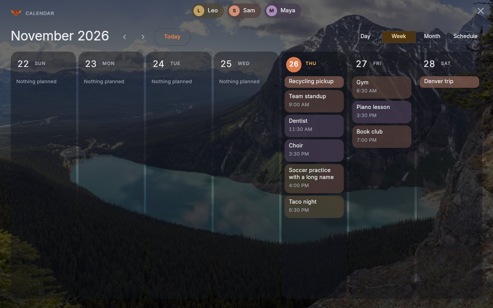
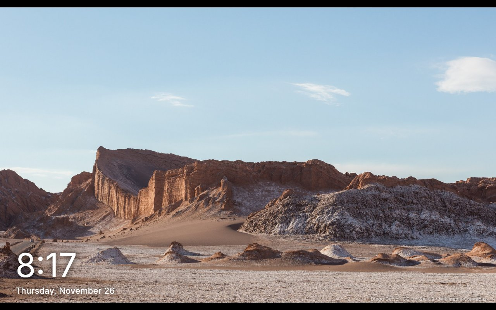
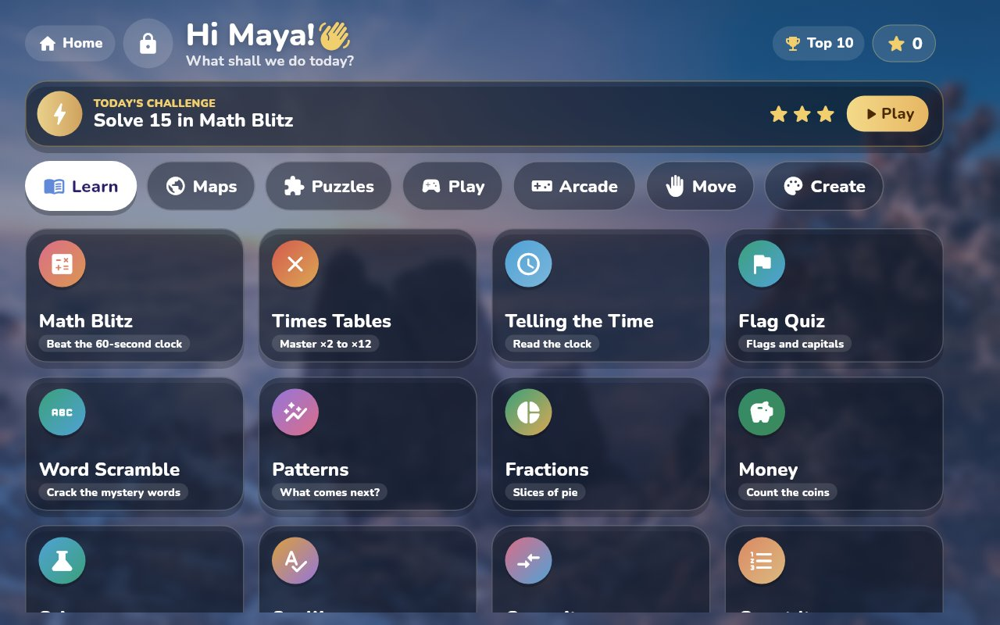
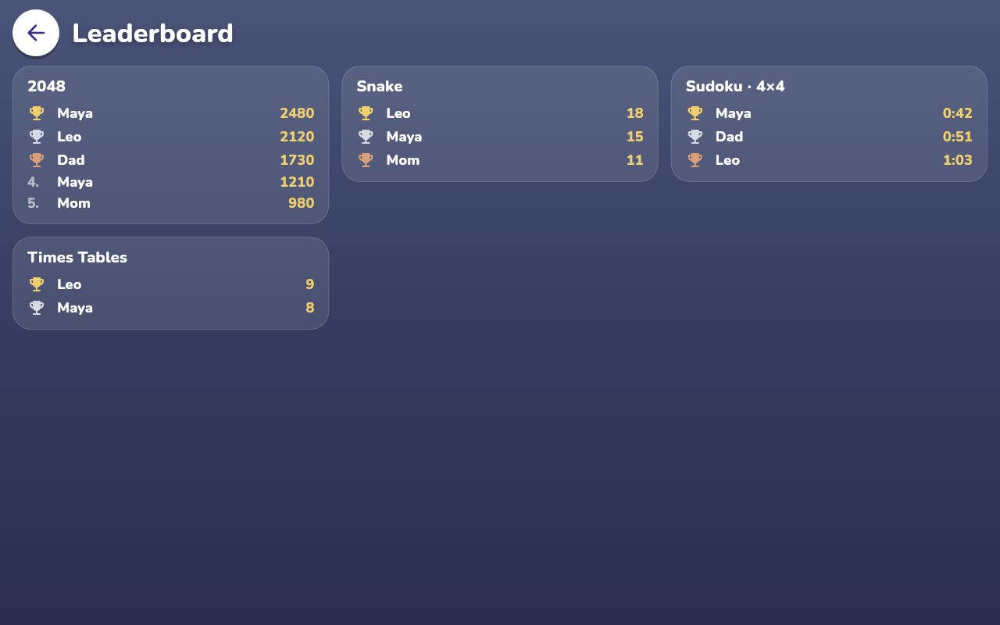
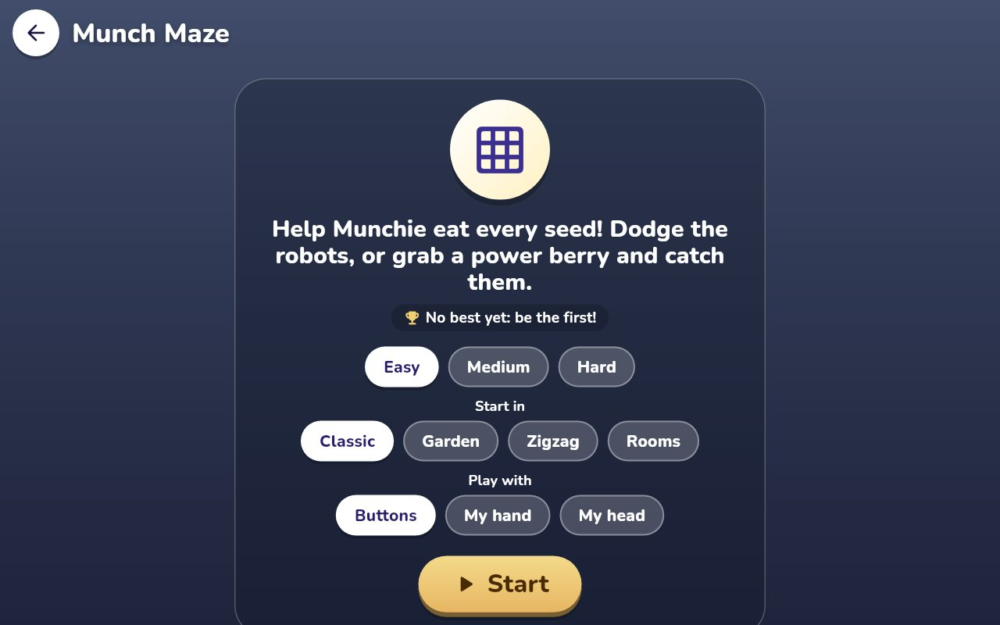
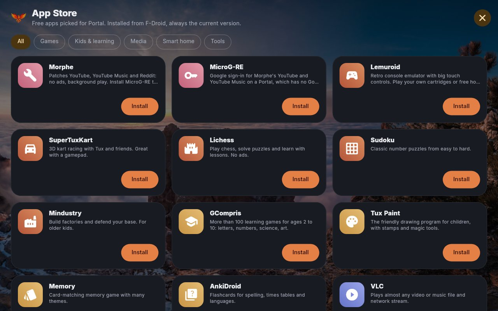

<h1 align="center">
  <picture>
    <source media="(prefers-color-scheme: dark)" srcset="assets/banners/ks_banner_dark.svg" />
    <source media="(prefers-color-scheme: light)" srcset="assets/banners/ks_banner_light.svg" />
    
  </picture>
</h1>

<p align="center">
  <b>Phoenix Portal</b> brings a Meta Portal back to life as a calm <b>home hub</b>, a <b>kids game portal</b> and a <b>photo frame</b>, with <b>Home Assistant</b> as an optional add-on.<br/>
  Fully local. No Facebook account. Built for the Portal's Android 9 and 10.
</p>

<p align="center">
  
</p>

<p align="center">
  <a href="https://github.com/rayalavcp/phoenix-portal/releases/latest"><b>Download the latest release</b></a> ·
  <a href="docs/wiki/Home.md">Wiki</a> ·
  <a href="install/README.md">Install guide</a> ·
  <a href="CHANGELOG.md">Changelog</a>
</p>

> The screenshots on this page are made from sample data (sample weather, calendar, shopping list
> and scores) on the app's built-in wallpapers. They show no real home or device.

## What it does

**A calm home screen.** The **Today** screen shows the time, the weather and a 4K landscape with
live weather effects: rain, snow, fog, a storm, and a half sun that moves along the top edge from
sunrise on the left to sunset on the right. Frosted glass cards show what's up next and
school. The dock opens the Kids Portal, Smart Home, **Calls** (the Portal's
own WhatsApp and Messenger calling), apps, school, the calendar, photos and settings. **Swipe
right** for Smart Home; swipe in from the left edge for the menu.

<p align="center">
  
</p>

**Tiles, like Android widgets.** Prefer tiles? Pick them under **Customize** (the sliders button
on the Today screen). Each tile shows live data and more of it as it
grows. Hold a tile, then drag it to move it, drag its corner to resize it, or tap × to hide it.
Spread tiles over **several home screens** and swipe between them. Pick a colour theme (Ember,
Ocean, Forest, Midnight, Sunset, Graphite) or **From wallpaper**, which takes its colours from
the photo on screen.

**Smart Home (Home Assistant, optional).** Lights, switches, fans, covers, locks, climate,
players, scenes and scripts by room, with favourites, and your full dashboard one tap away.
Without Home Assistant, everything else works the same.

<p align="center">
  
  
</p>

**Shopping list.** Home Assistant's own to-do lists on a tile and a big touch page: tick items
off, add new ones, clear the done ones. The same list the Home Assistant app and voice assistants
use.

**Family calendar.** Home Assistant calendars in Day, Week, Month and Schedule views, a colour per
person, on the same frosted glass. **Timers** start in one tap (1, 5, 10, 15 or 30 minutes), and
**alarms** can wake you with a sunrise.

<p align="center">
  
</p>

**Telugu calendar (optional).** Turn it on under **Customize** (or in the remote admin): a full
panchangam computed on the Portal for your city (tithi, nakshatra, yoga, karana, masa, paksha,
ritu and samvatsara, sunrise and sunset, Rahu Kalam and Yamagandam), the Telugu festivals in a
month view and a Telugu word of the day. It is off on a new install.

**School.** This week's breakfast and lunch menus from SchoolCafe for your school (pick it with
**Set up** on the School page), your district's calendar and a "school starts in 20 min" line.
Nothing is set up by default.

**Photo frame.** Your photos from Immich or a network folder. With nothing set up, the frame shows
the built-in 4K landscapes, slowly drifting, with the clock and each photographer's credit.

<p align="center">
  
</p>

**Kids Portal.** A calm game hub, offline and ad-free, on seven shelves:

<p align="center">
  
</p>

| Shelf | Games |
|---|---|
| **Learn** | Math Blitz, Times Tables, Telling the Time, Flag Quiz, Word Scramble, Patterns, Fractions, Money, Science, Spelling, Opposites, Count It, Letter Sounds, Place Value, Story Sums, Telugu Words. Levels with stars and **Next level** after a good round. |
| **Maps** | USA (50 states), India (28 states and 8 union territories) and World: find it, name it, capitals, continents, flags, fill the map, shape memory. |
| **Puzzles** | Sudoku, Maze, Word Search, Word Guess, Memory Pro (6 to 12 pairs), 2048, Lights Out: a new puzzle every round. |
| **Play** | Snake, Whack-a-Mole, Simon Says, Tic-Tac-Toe, Connect Four. |
| **Arcade** | Munch Maze (a new maze every stage), Brick Bash (a new wall every stage), Hop Across, Sky Glide, Fox Run: original retro games. |
| **Move** | Camera games: Space Blaster, Bubble Pop, Fruit Catcher, Finger Math, Wall Dodge, Air Trace, Freeze Dance. Each hand is a soft bubble cursor; every game also plays by touch. |
| **Create** | Draw Studio, Pixel Paint, Piano. |

<p align="center">
  
  
</p>

A score that makes a game's **top 10** asks for a name, arcade style, and the **Top 10** page
lists every game's leaderboard. A daily challenge earns bonus stars. Parents get a daily
screen-time budget, a bedtime window and a parent PIN.

**App Store.** Free apps picked for the Portal, installed from F-Droid's current builds, plus
**Morphe** and **MicroG-RE** from GitHub with update checks. The remote admin installs **any APK**
by link or upload (the Portal's browser won't download APKs). See [install/MORPHE.md](install/MORPHE.md).

<p align="center"></p>

**Everything Kiosk Satellite does.** Phoenix is built on Kiosk Satellite and keeps all of it:
Assist voice control with wake words, synchronized music (Music Assistant, AirPlay), screensavers,
camera motion and presence wake, ESPHome entities in Home Assistant, intercom between Portals,
alarms, timers, gestures, remote administration and fleet management.

**Made for the Portal.** Phoenix fixes the first-generation Portal's white-on-white installer
dialog, can block Meta OS updates, takes over the home screen, and updates itself from this
repository's [releases](https://github.com/rayalavcp/phoenix-portal/releases).

## Install

- **A new Portal:** use [Phoenix Control](control/) in Chrome or Edge over USB, the Windows
  installer `install/install-phoenix.ps1`, or `provisioning/phoenix-provision.sh`. Step by step:
  [install/README.md](install/README.md) and the [wiki](docs/wiki/Install.md).
- **Updates:** the Portal checks this repository's releases on start and every 12 hours, and
  shows **Update available** in the menu. The newest APK is always at
  [releases/latest](https://github.com/rayalavcp/phoenix-portal/releases/latest/download/phoenix-portal.apk).

<p align="center"></p>

## Home Assistant

The Portal appears in **Settings → Devices & services** as a discovered ESPHome device, with its
screen, volume, sensors, cameras and media, plus:

- `select.<portal>_profile`: Family / Kids / Night
- `sensor.<portal>_kids_time_left`: minutes of screen time left today

```yaml
# Kids mode after school on weekdays, bedtime screen at night.
automation:
  - alias: Portal kids mode after school
    trigger: { platform: time, at: "15:30:00" }
    condition: { condition: time, weekday: [mon, tue, wed, thu, fri] }
    action:
      - action: select.select_option
        target: { entity_id: select.kids_room_portal_profile }
        data: { option: Kids }
  - alias: Portal bedtime
    trigger: { platform: time, at: "20:30:00" }
    action:
      - action: select.select_option
        target: { entity_id: select.kids_room_portal_profile }
        data: { option: Night }
```

## Documentation

- **[Wiki](docs/wiki/Home.md):** a guide to every screen, setup and troubleshooting.
- **Phoenix:** [plan and status](docs/phoenix/PLAN.md), [Meta Portal guide](docs/portal.md),
  [replacing Immortal](docs/phoenix/IMMORTAL.md), [updates](install/UPDATES.md),
  [Phoenix Control](control/README.md)
- **Display:** [screen](docs/screen.md), [screensavers](docs/screensavers.md),
  [Immich](docs/immich.md), [custom pages](docs/custom-pages.md), [At a Glance](docs/at-a-glance.md)
- **Voice and media:** [Voice Satellite](docs/voice-satellite.md), [microphone](docs/microphone.md),
  [music](docs/sendspin.md), [music library](docs/music-library.md), [intercom](docs/intercom.md),
  [cameras](docs/cameras.md), [DLNA](docs/dlna.md)
- **Kiosk:** [lockdown](docs/kiosk.md), [home launcher](docs/home-launcher.md),
  [gestures](docs/gestures.md), [alarms](docs/alarms.md), [timers](docs/timers.md),
  [calendar](docs/calendar.md), [permissions](docs/permissions.md)
- **Automation and management:** [ESPHome](docs/esphome.md), [fleet](docs/fleet.md),
  [remote API](docs/remote-api.md), [TLS](docs/tls.md), [JavaScript API](docs/js-api.md),
  [plugins](docs/plugins.md)
- **Working on Phoenix (people and AI agents):** [HANDOFF.md](HANDOFF.md)

## Build from source

Flutter 3.44.6, Java 21, Android SDK platform 36, Node 22 (for the remote admin).

```bash
cd app/remote-ui && npm install && npm run build   # the remote admin
cd .. && flutter pub get
flutter build apk --release --split-per-abi --target-platform android-arm
flutter analyze lib test && flutter test           # Dart tests
node --test test/*_test.mjs                        # remote admin tests
```

Release builds are signed with the project key through `app/android/key.properties` (never
committed); a build signed with another key cannot update the Portals. Builds ship as GitHub
Releases with `install/publish_release.sh`. All of it is in [HANDOFF.md](HANDOFF.md).
Analytics are **off**, and nothing is sent to the original project.

## Credits

Phoenix Portal is built on [Kiosk Satellite](https://github.com/jxlarrea/kiosk-satellite) by Xavier
Larrea (CC BY-NC-ND 4.0), with its Portal setup steps and Calls link based on
[Immortal](https://github.com/starbrightlab/immortal) by Starbright Lab (MIT), and ideas from
[OpenPortal](https://openportal.cc). Phoenix Control uses
[Tango ADB](https://github.com/yume-chan/ya-webadb). Wallpapers: Wikimedia Commons photographers,
credited in [wallpapers/CREDITS.md](wallpapers/CREDITS.md). Fonts: Inter, Nunito and Rubik (SIL
OFL). Icons: Material Design. See [LICENSE](LICENSE) and [CHANGELOG.md](CHANGELOG.md).

Not affiliated with Meta. "Portal" is a trademark of Meta Platforms, Inc., used only to name the
hardware Phoenix Portal runs on.
