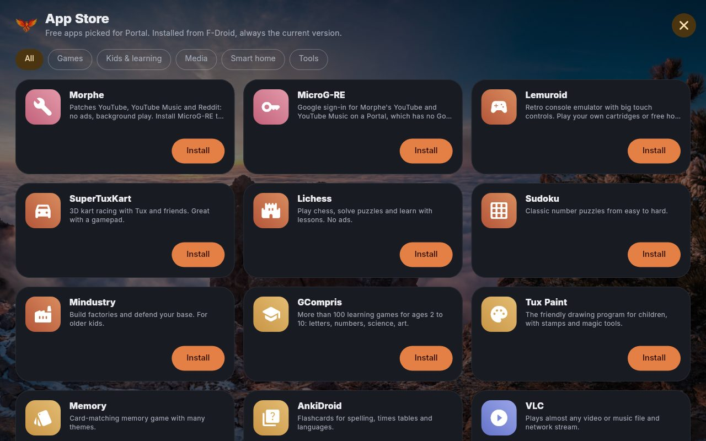

# App Store and side-loading

**Apps** in the dock (or the App Store tile) lists free apps picked for the Portal: games,
learning, media, smart home and tools. **Install** downloads the current build from F-Droid and
hands it to Android's installer (tap **Install** on the screen), or installs silently when
Shizuku is set up.

**Morphe** and **MicroG-RE** come from their GitHub releases, with **Update** when a newer one is
out. MicroG-RE gives YouTube and YouTube Music Google sign-in on a Portal.

## Any APK

The Portal's browser won't download APK files. Instead, in the remote admin's **Phoenix** page,
**Install apps on this Portal**:

- **Upload an APK** from the computer.
- **Install from a link** to an `.apk` file: the Portal downloads it itself.

Split bundles (APKM, APKS, XAPK) must be merged into one APK first.

## Patched YouTube (Morphe)

Patching needs more memory than a Portal has, so it runs on a Windows PC:
[install/MORPHE.md](https://github.com/rayalavcp/phoenix-portal/blob/main/install/MORPHE.md) and
`install/patch-morphe.ps1`.
