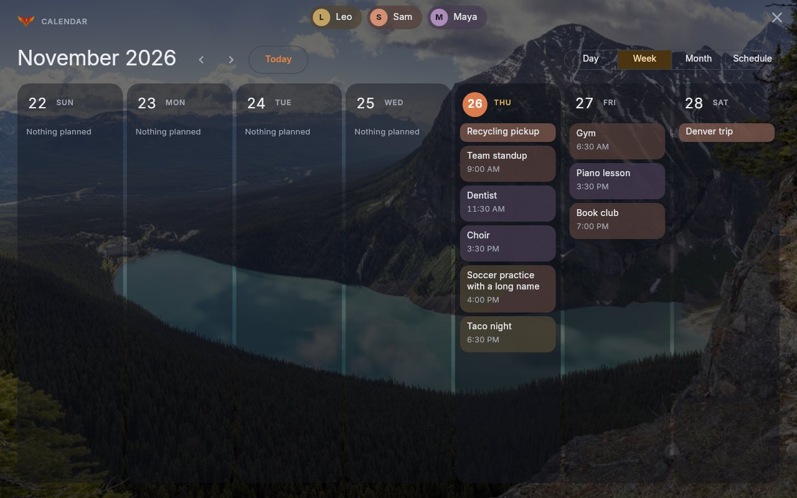

# Calendars, school and timers

## Family calendar

Home Assistant calendars as a family calendar: **Day, Week, Month and Schedule** views, a colour
and avatar per person, shared events split between colours. Add calendars in Settings ›
Calendar. Open it from the dock, a tile, or by voice.

## School

The School page shows this week's breakfast and lunch menus from SchoolCafe, the school
district's calendar (holidays, early release) and a "school starts in 20 min" line. Nothing is set
up on a new install: tap **Set up** on the page, pick your district and school, and paste your
district's calendar link (an iCal `.ics` address) if it has one.

## Telugu calendar

Optional, and off on a new install: turn it on under **Customize** › **Telugu calendar** on the
Today screen, or in the remote admin (**Phoenix** › **Telugu calendar**). A full panchangam computed on the Portal for your city (tithi, nakshatra, yoga, karana, masa,
paksha, ritu, samvatsara, sunrise and sunset, Rahu Kalam, Yamagandam) and the Telugu festivals in
a month view, plus a Telugu word of the day on the Today screen.

## Timers and alarms

Set timers by voice or by hand. With no timer running, the Timers tile and screen offer
one-tap **1, 5, 10, 15 and 30 minute** timers. Timers can show and ring on other Portals too
(shared timers). Alarms ring on the Portal itself, without Home Assistant, and can wake you with
a **sunrise** that brightens the screen first.
