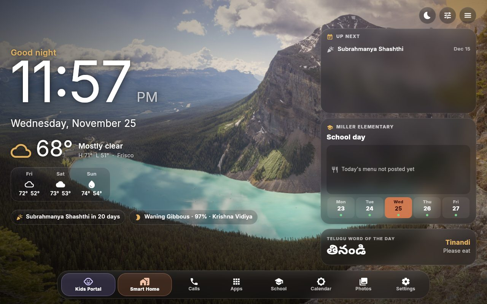

# Phoenix Portal wiki

Phoenix Portal turns a Meta Portal into a calm **home hub**, a **kids game portal** and a
**photo frame**, with **Home Assistant** as an optional add-on. It runs fully on the Portal: no
Facebook account, no cloud service.

*Screenshots in this wiki use sample data on the app's built-in wallpapers.*

## Start here

| I want to | Page |
|---|---|
| Put Phoenix on a Portal | [Install](Install.md) |
| Learn the home screen, tiles and themes | [Today screen and tiles](Today-and-Tiles.md) |
| Set up games for the kids | [Kids Portal](Kids-Portal.md) |
| Control lights and use the shopping list | [Smart Home and shopping list](Smart-Home.md) |
| See the family calendar, school, timers | [Calendars, school and timers](Calendars-and-Timers.md) |
| Show photos or landscapes when idle | [Photos and screensavers](Photos-and-Screensavers.md) |
| Install other apps | [App Store and side-loading](App-Store.md) |
| Manage a Portal from a computer | [Remote admin](Remote-Admin.md) |
| Get new versions | [Updates](Updates.md) |
| Fix a problem | [Troubleshooting](Troubleshooting.md) |
| Change the code or build it | [For developers](For-Developers.md) |

## What is in it

- **Today screen** with the time, weather, a 4K landscape with live weather (rain, snow, fog,
  storms, and a sun that crosses the top edge through the day), frosted glass cards and a dock.
- **Tiles** you move and resize like Android widgets, on several swipeable home screens, in six
  colour themes or colours taken from the wallpaper.
- **Kids Portal**: more than 50 offline games on seven shelves, top-10 leaderboards, a daily
  challenge, screen time, bedtime and a parent PIN.
- **Home Assistant** (optional): Smart Home controls, the shopping list, the family calendar,
  cameras, the doorbell, and the Portal in Home Assistant through ESPHome.
- **Telugu calendar** (panchangam) and **school** menus and calendar.
- **Photo frame** from Immich or a network folder, or built-in landscapes when nothing is set up.
- Everything from **Kiosk Satellite**, which Phoenix is built on: voice assistant, music,
  intercom, alarms, gestures, remote administration and fleet management.

Phoenix Portal is built on [Kiosk Satellite](https://github.com/jxlarrea/kiosk-satellite) by
Xavier Larrea (CC BY-NC-ND 4.0), with Portal setup steps based on
[Immortal](https://github.com/starbrightlab/immortal) by Starbright Lab (MIT).
