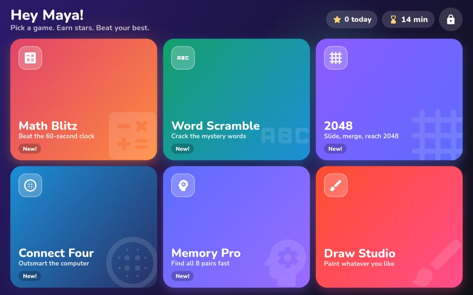
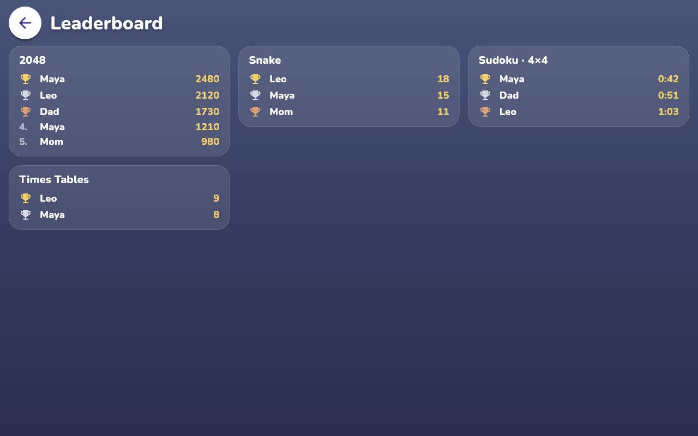

# Kids Portal

A calm game hub for children, offline and ad-free. Open it from the dock or the Kids tile.

## Shelves

| Shelf | Games |
|---|---|
| **Learn** | Homework, Math Blitz, Times Tables, Telling the Time, Flag Quiz, Word Scramble, Patterns, Fractions, Money, Science, Spelling, Opposites, Count It, Letter Sounds, Place Value, Story Sums, Telugu Words |
| **Maps** | USA, India and World: find it, name it, capitals, continents, flags, fill the map, shape memory |
| **Puzzles** | Sudoku, Maze, Word Search, Word Guess, Memory Pro, 2048, Lights Out |
| **Play** | Snake, Whack-a-Mole, Simon Says, Tic-Tac-Toe, Connect Four, Star Swipe (swipe through the stars, miss the storm clouds), Stack Up (drop each block to build a tower) |
| **Arcade** | Munch Maze, Brick Bash, Hop Across, Sky Glide, Fox Run |
| **Move** | Camera games: Space Blaster, Bubble Pop, Fruit Catcher, Finger Math, Wall Dodge, Air Trace, Freeze Dance, Goalie (save the shots), Window Wipe (wipe the frost off a window), Pose Match, Simon Poses, Pop Duel (two players) |
| **Create** | Draw Studio, Pixel Paint, Piano |

Puzzles, mazes and brick walls are new every round. Quizzes have levels with stars and **Next
level** after a good round.

## Leaderboards

A score that makes a game's **top 10** shows **New high score!** and asks for a name (names
used before are one tap away). **Top 10** on the hub lists every game's leaderboard, with gold,
silver and bronze trophies. Each level or size has its own board; for timed games the fastest
time wins.

## Camera games

The Move shelf uses the Portal's camera to follow hands or the head; each hand is a soft
bubble cursor. Nothing is recorded or sent. The camera must be allowed in Settings › Camera; it
runs only while a camera game is being played. Every game also plays by touch.

## For parents

In the Kids Portal's lock menu (parent PIN or a three-second press on the lock), or in the
remote admin's **Phoenix** page:

- **Daily screen time** and a **bedtime** window.
- **Parent PIN** to leave the portal or add time.
- Which games show, the child's name, and **reset scores** (clears the leaderboards too).
- Apps from the App Store a child may open (shown above the games).

The **Profile** (Family, Kids, Night) can switch from Home Assistant, the remote admin or the
Portal itself. Kids keeps the screen on the Kids Portal; Night shows a calm bedtime clock.

## Homework

A grown-up sets this week's **spelling words** and **times tables**: on the Portal, open
**Homework** on the Learn shelf and tap **Set homework (grown-ups)** (it asks for the parent PIN
when one is set), or in the remote admin under **Phoenix** › **Homework**. The child practises:

- **Spelling:** look, cover, write, check. The word shows for a few seconds, hides, and the child
  types it on a big keyboard. A word spelled wrong comes back once at the end.
- **Times tables:** each question typed on a number pad, from the tables set only.

The remote admin shows the last seven days: how many words and sums were tried and how many were
right.

## Playing with two children

One-player camera games follow one child, even with another in view. **Pop Duel** is made for
two: stand side by side, Pink pops on the left and Blue on the right.

