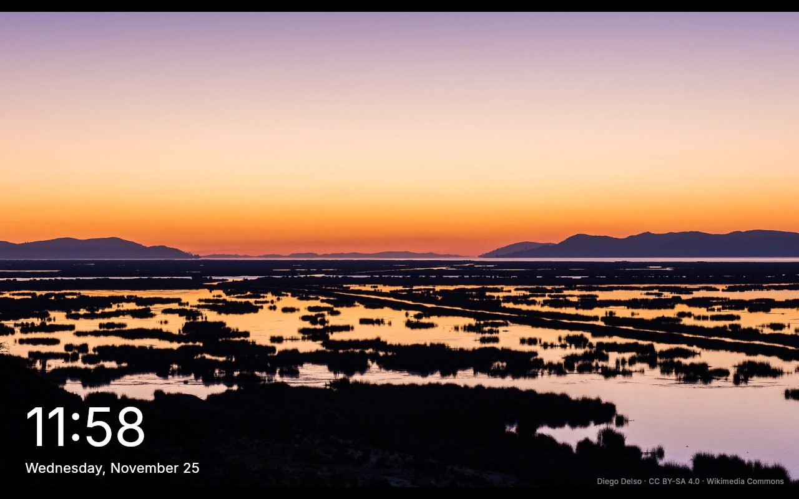

# Photos and screensavers

## Phoenix Photo Frame

Shows your photos full screen with the clock and date. Set the source with the **Photos** tile:

- **Immich**: your Immich server's address and an API key, and an album.
- **A network folder** served over http (for example from a NAS).

**With nothing set up**, the photo frame shows the 14 built-in 4K landscapes instead: each one
slowly zooms and drifts, then fades into the next, with the photographer's credit in the corner.
Each landscape downloads once, then stays on the Portal.

## Using it as the screensaver

Settings › Screensaver: turn the screensaver on, set the idle time, and pick **Phoenix Photo
Frame** as the mode. Other modes: Clock, Weather Mood, Celestial (a live night sky), Calendar,
Immich Media, local media, an image link, a website, camera streams and more. The Portal's
presence sensor, motion or a face can wake the screen.
