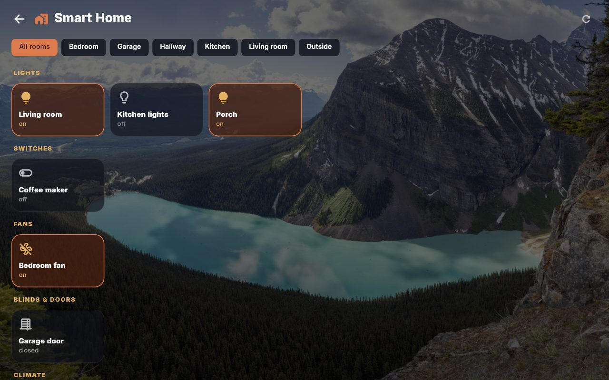
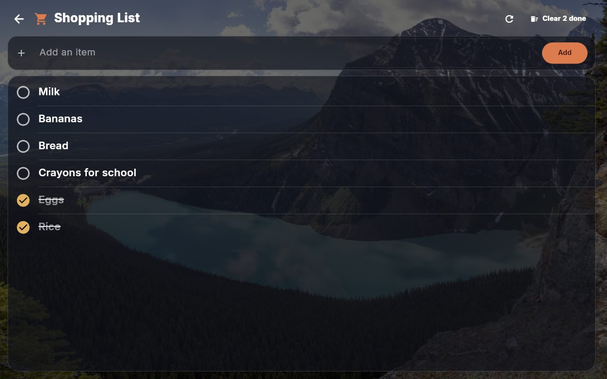

# Smart Home and shopping list

Home Assistant is optional. Connect it in the setup wizard or Settings › Home Assistant (its
address and a long-lived access token).

## Smart Home page

Swipe right on the Today screen or tap **Smart Home** in the dock. By default this opens your
Home Assistant dashboard; **Customize** (sliders button on the Today screen) › Smart Home
button can open Phoenix's own
controls instead: lights, switches, fans, covers, locks, climate, players, scenes and scripts,
by room, with favourites pinned to the top. Tap to toggle; hold for more.

## Shopping list

The **Shopping** tile shows how many items are left and the first few. Tap it for the list:
tap an item to tick it off, type in **Add an item**, **Clear done** removes the ticked ones,
and the list button switches between your Home Assistant to-do lists. It is Home Assistant's own
to-do list (add the **Shopping List** integration in Home Assistant if you have none), so the
Home Assistant app and voice assistants see the same items.

## The Portal in Home Assistant

The Portal appears in Home Assistant under **Settings → Devices & services** as a discovered
**ESPHome** device: screen, brightness, volume, sensors, cameras, media, plus Phoenix's
`select.<portal>_profile` (Family / Kids / Night) and `sensor.<portal>_kids_time_left`.
Example automations are in the
[README](https://github.com/rayalavcp/phoenix-portal#home-assistant).

## Now Playing

To follow other apps' music (Now Playing), the Portal needs **Notification access**. A Portal
has no settings screen for it, so **Grant on device** grants it through Shizuku when Shizuku is
set up; the PC installer, Phoenix Control and the provisioning script grant it over USB.
