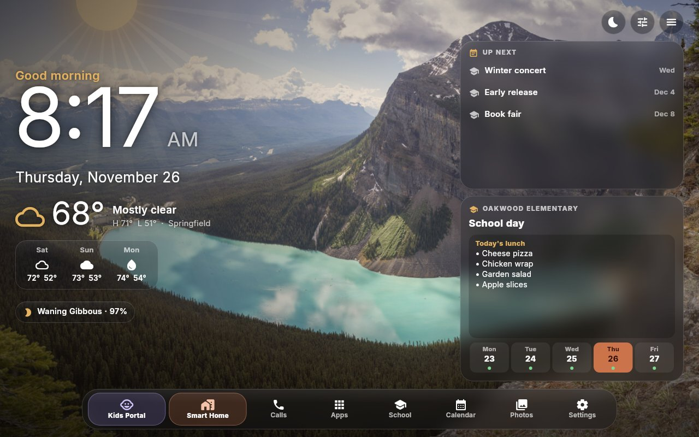
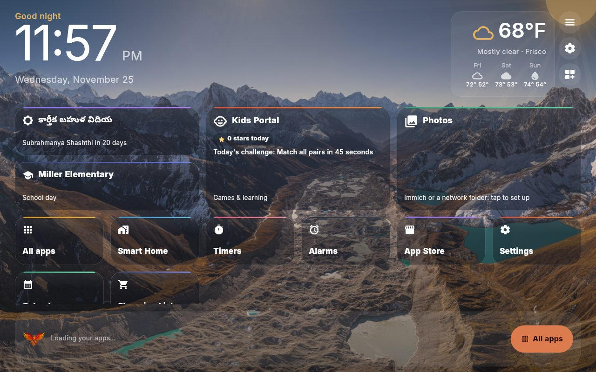

# Today screen and tiles

## Today screen

The default home screen: the time and date, the weather for your city with the next days, and
a 4K landscape that changes every few hours. The weather is drawn on the picture: rain, snow,
fog, a storm, stars at night, and a half sun that moves along the top edge from the left at
sunrise to the right at sunset.

The cards on the right show what's up next and school; with the
optional Telugu calendar on, also Telugu festivals and a Telugu word of the day. Home Assistant cameras can show live in a card (swipe across it to switch
camera), and a doorbell ring shows its camera full screen for 30 seconds.

The **dock** opens the Kids Portal, Smart Home, **Calls** (the Portal's own WhatsApp and
Messenger calling), all apps, school, the calendar, photos and settings.

- **Swipe right** anywhere: Smart Home.
- **Swipe in from the left edge**: the menu.

## Tiles

Prefer tiles? Tap **Customize** (the sliders button, top right of the Today screen) › Layout ›
**Tiles**. Each tile shows live data, and more
of it as it grows.

- **Edit:** hold any tile (or tap the edit button).
- **Move:** drag a tile onto another place.
- **Resize:** drag the round handle on its bottom-right corner. It snaps to whole cells and shows
  the size.
- **Hide:** tap × on its top-left corner. Hidden tiles come back from the edit bar.
- **Another home screen:** tap the handle on its top-right corner, then **Move to Home 2** (or a
  new home screen). Swipe between home screens; dots show which one is up. Up to five.

### Your own tiles

In edit mode, tap **New tile** on the edit bar and pick what it shows:

- **Smart home device:** any Home Assistant entity. The tile shows its state (a temperature, a door,
  a light) and a tap switches lights, switches, fans, locks, covers, scenes and scripts.
- **Web page:** a tap opens it over the home screen.
- **Camera:** a Home Assistant camera; the tile shows a still every 10 seconds and a tap shows it
  big.
- **App:** opens the app.

The pencil on a custom tile (bottom left, in edit mode) changes or deletes it.

The remote admin's **Phoenix** page edits the same tiles: size, order, screen and whether each
shows, and adds, changes or deletes your own tiles under **Custom tiles**.

## Clock faces

**Customize** › **Clock**: Classic, Bold, Flip cards, Analogue or Words ("It's twenty to ten").
The Phoenix Photo Frame uses the same face. Also in the remote admin (**Phoenix** › **Look**).

## Themes and wallpapers

Pick a colour theme under **Customize** › Colours (or in the tiles' edit bar): **From wallpaper** (colours taken from the picture on
screen), Ember, Ocean, Forest, Midnight, Sunset or Graphite. Wallpapers: 14 built-in 4K
landscapes (credited in
[wallpapers/CREDITS.md](https://github.com/rayalavcp/phoenix-portal/blob/main/wallpapers/CREDITS.md)),
11 minimal ones, Bing's photo of the day, your own photos or an image link (Customize ›
Wallpaper). The **Glass** slider sets how see-through the cards are; Customize also sets the
weather effects, the Smart Home button, cameras, the doorbell and the menu.
